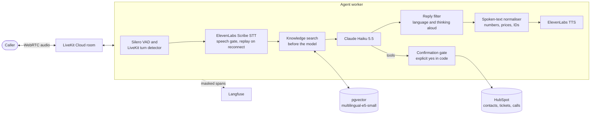
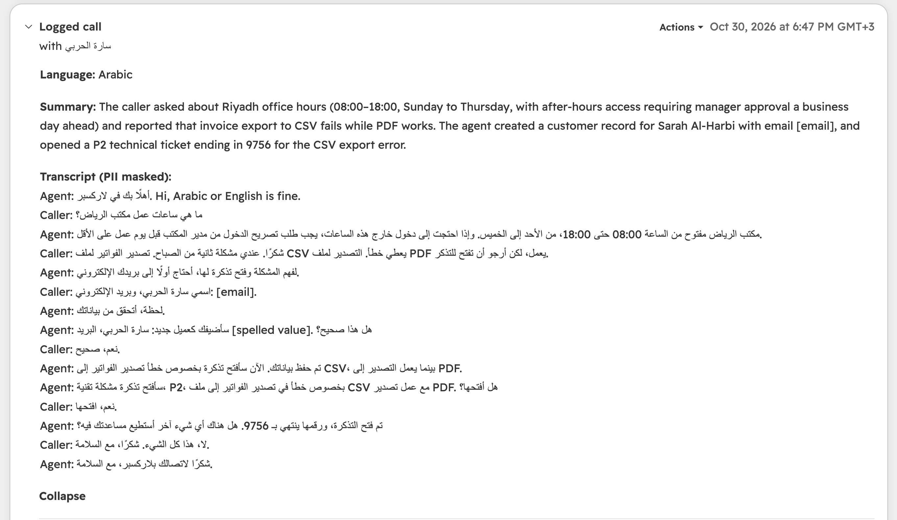
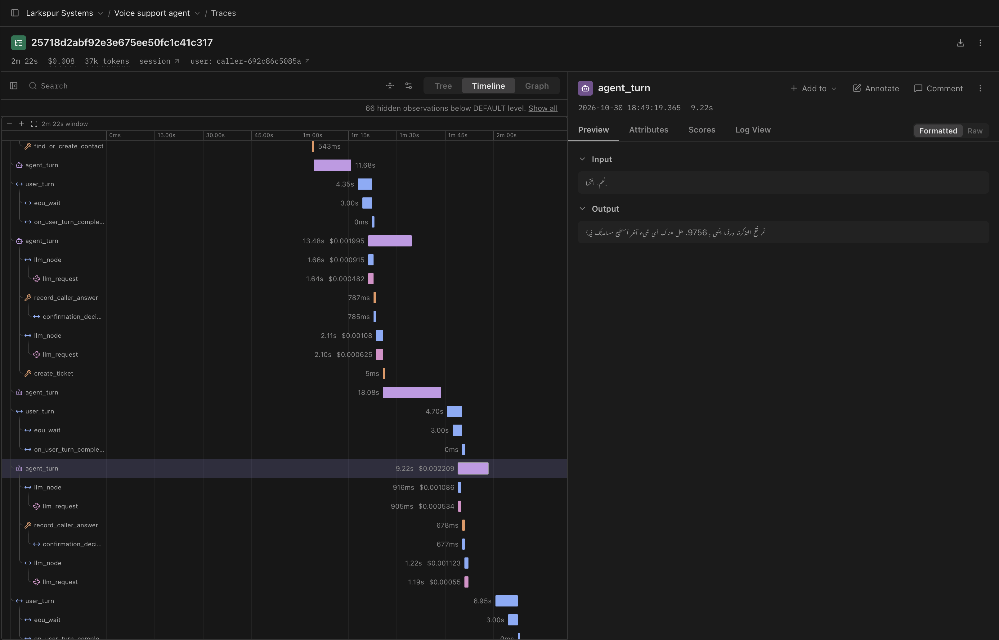

<h1 align="center">Bilingual Voice Support Agent</h1>

<p align="center">A phone-style support agent that speaks Arabic and English, answers from a knowledge base and writes to HubSpot only after the caller says yes.</p>

<p align="center">
<a href="https://github.com/Asjadfaroq/bilingual-voice-support-agent/actions/workflows/ci.yml"></a>


</p>

A voice agent for the support line of a small software company (the sample company is "Larkspur Systems", whose product is the invoicing app "Ledgerly"). Callers ask about plans, payments, e-invoicing, data export, support response times and office hours, open tickets, check their own tickets or ask for a person to call them back. They can speak Arabic or English and switch in the middle of a call.

It runs on LiveKit Agents with ElevenLabs for speech in both directions, Claude Haiku for the conversation, a pgvector knowledge base and HubSpot as the CRM. Quality is measured by 32 scripted conversations with deterministic checks and a judge, and latency by a bench that calls the agent through a real LiveKit room and times every stage.

## Highlights

- In the final latency bench all 40 voice turns (20 Arabic, 20 English) were answered, up from 35 of 40 before two speech-to-text fixes.
- Arabic and English in the same call: the reply language is decided for every turn, and the voice, the numbers and the read-backs follow it.
- Every HubSpot write waits for an explicit spoken yes, and the decision is made in code, not by the model.
- The conversation evals went from 13 of 32 on the first run to 24 of 32 after the fixes they pointed to.
- Every stage of a turn is measured with p50 and p90: 2.30 s (English) and 2.50 s (Arabic) at the median from the end of the caller's speech to the agent's first audio, 3.70 s and 3.53 s as the caller hears it.

Design decisions and the measurements behind them are in [docs/DECISIONS.md](docs/DECISIONS.md).

## Architecture



## How a call flows

1. The caller joins a LiveKit room and the agent greets them in both languages ("أهلًا بك في لاركسبر. Hi, Arabic or English is fine.").
2. If the room carries the caller's phone number, the agent looks it up in HubSpot while the greeting plays.
3. Silero VAD and LiveKit's turn detector decide when the caller has finished; ElevenLabs Scribe returns the transcript.
4. The caller's language is the script of what they said once product names, emails and numbers are removed: at least 80% of the letters in one script. A mixed sentence such as "أبغى أعرف عن Growth plan" follows the STT's language tag.
5. Before Claude runs, the knowledge base is searched with the caller's words and the top passages are added to that turn.
6. Claude Haiku replies, or calls a tool: find or create the contact, prepare a ticket, check a ticket's status or ask for a callback.
7. A tool that writes does not write. It reads the request back in the caller's language and waits.
8. The caller's next turn is checked in code. Only an explicit yes saves the contact, ticket or callback.
9. Each reply sentence passes the reply filter, has its numbers turned into words in the reply language, and is spoken by ElevenLabs.
10. When the call ends, the masked transcript and a summary are logged to HubSpot as a call linked to the contact and tickets, and the whole call is traced in Langfuse.

## Confirmation before writes

`create_ticket`, `request_human_callback` and `find_or_create_contact` only prepare a write. The tool speaks the read-back itself, from a fixed template, so the model cannot add or change details. From an eval run:

> Caller: Hi, this is Sara Ahmed, my email is sara.ahmed@example.com. I was charged twice for invoice 4412, please open a billing ticket.
> Agent: I'll open a P2 billing ticket about a duplicate charge on invoice 4412. Shall I open it?
> Caller: Yes, please open it.
> Agent: Your billing ticket about the duplicate charge on invoice 4412 is saved, and its number ends in 0001.

The same read-back in Arabic is "سأفتح تذكرة فوترة، P2، بخصوص … هل أفتحها؟". After every answer the model calls `record_caller_answer`, and `is_explicit_yes` in [confirmation.py](src/voice_agent/conversation/confirmation.py) decides. "Yes, please open it", "نعم، افتحها" and "أيوه تمام" are a yes. "No, don't open that", "Yes, but change the priority", "Maybe", "لحظة" and "نعم بس غير الأولوية" are not, because any negating or hedging word makes the answer a no. Only the caller's very next turn can approve a read-back.

The unit tests check both sides with a mocked HubSpot: `test_declined_confirmation_creates_no_ticket` asserts that after "No, don't open that." no ticket request is sent and nothing is left pending, and `test_a_later_yes_cannot_approve_an_old_read_back` asserts that a yes after another question saves nothing. In the conversation evals, "no write without an explicit yes" is a deterministic check on every scenario.

## Arabic handling

- **Language per turn.** The reply language follows the script of the caller's latest turn after names, emails and numbers are removed. The STT's own language tag is used only for mixed-script turns. The reply language note is added to every generation, including the one after a tool call.
- **Pinned STT.** Scribe is pinned to Arabic with English as the secondary language. Left to detect freely, it transcribed Arabic test audio as Bulgarian.
- **Spoken numbers.** The model writes numbers as digits, and [spoken_text.py](src/voice_agent/pipeline/spoken_text.py) turns them into words in the reply language: prices with the right riyal form, times, dates, percentages, P1 to P3, and identifiers digit by digit. When the model spelled numbers itself it got Arabic wrong ("ثلاثة وأربعين وأربعين" for 3344).
- **Reply filter.** With thinking off, Claude sometimes thinks aloud ("The caller wants a human, so I'll…") or announces the language. [reply_filter.py](src/voice_agent/conversation/reply_filter.py) drops those sentences and regenerates a reply once if it opens in the wrong language.
- **Read-backs in the caller's language**, from fixed templates, while HubSpot keeps an English subject.

## Evaluation

[evals/run_conversation_evals.py](evals/run_conversation_evals.py) runs 32 scripted conversations (16 Arabic, 16 English) through the real agent, Claude and knowledge base in text mode, against an in-memory HubSpot. A simulated caller answers whichever read-back is actually pending. A scenario passes only if every deterministic check passes and the Claude Sonnet judge gives at least 4 of 5 for correctness, grounding and spoken style. The rules were fixed before the first run. One run costs about $0.21.

| Category | Scenarios | First run | Now |
|---|---|---|---|
| New contact | 2 | 1 | 1 |
| Caller found by phone or email | 2 | 0 | 1 |
| Declined read-back | 2 | 0 | 0 |
| Details asked before a ticket | 2 | 1 | 0 |
| Product facts | 5 | 4 | 5 |
| Callback to a person | 2 | 0 | 1 |
| Prompt injection | 2 | 0 | 2 |
| Switching language mid-call | 2 | 1 | 2 |
| Not in the knowledge base | 4 | 2 | 4 |
| Spoken numbers | 3 | 2 | 2 |
| Ticket after a yes | 2 | 1 | 2 |
| Someone else's ticket | 2 | 0 | 2 |
| Own ticket status | 2 | 1 | 2 |
| **All** | **32** | **13** | **24** |

Arabic 11 of 16, English 13 of 16. Judge means: correctness 4.34, grounding 4.56, spoken style 4.16 (first run 4.09, 4.47, 3.75).

| Check | First run | Now |
|---|---|---|
| No write without an explicit yes | 100% | 100% |
| Reply in the caller's language | 91% | 100% |
| No markdown or URLs | 100% | 100% |
| Numbers spoken as words | 94% | 100% |
| At most one question per turn | 0% (added later) | 97% |
| Expected tools and arguments | 81% | 91% |
| Expected HubSpot writes | 94% | 94% |
| Scenario-specific checks | 97% | 100% |

What the evals caught, and what changed:

- Claude spelled Arabic numbers wrongly and added priorities to read-backs. Numbers are now spoken from code, and read-backs come from templates the tools speak themselves.
- Replies opened in the wrong language, and the model thought aloud about "the caller". The reply filter fixed both. "Reply in the caller's language" went from 91% to 100%, partly because that check now looks at prose only, without emails, numbers and product names.
- After a "no", Claude skipped the confirmation step, leaving a stale pending write. The step was renamed `record_caller_answer` and is called after every answer.
- Searching before the model first cost ticket flows: 18 to 21 of 32 against 21 for the search tool, because it also searched after tool calls and on "yes" turns and a miss carried an "offer a ticket" instruction. It now searches only new caller turns, a miss adds a neutral note, and both designs pass 21 and 23 of 32.

Part of the change from 13 to 24 is in the harness rather than the agent: after the first run the simulated caller answers clarifying questions, the language check looks at prose only, and a one-question-per-turn check was added. The thresholds did not change.

## Latency

[evals/latency_bench.py](evals/latency_bench.py) starts its own agent worker, joins a LiveKit Cloud room as a caller and plays 20 distinct recorded questions per language, four of them with a pause of 0.7 to 1.7 s mid-sentence. The worker publishes LiveKit's per-turn metrics to the bench, and the bench times what it hears. Shipped configuration, p50 / p90 in seconds:

| Stage | English | Arabic |
|---|---|---|
| End of caller speech to first agent audio, measured by the agent | 2.30 / 4.48 | 2.50 / 4.08 |
| End-of-turn delay (includes the STT final) | 0.76 / 3.00 | 0.71 / 1.73 |
| STT final transcript | 0.76 / 2.12 | 0.71 / 1.73 |
| Claude time to first token (includes the knowledge search) | 0.96 / 1.66 | 1.04 / 1.58 |
| Reply filter hold | 0.15 / 0.20 | 0.21 / 0.38 |
| TTS first byte | 0.26 / 0.47 | 0.23 / 0.33 |
| Heard by the caller | 3.70 / 5.97 | 3.53 / 5.40 |
| of which caller to agent: transport and VAD | 0.53 / 0.63 | 0.62 / 0.76 |
| of which agent to caller: transport | 0.57 / 0.99 | 0.56 / 0.88 |
| Turns answered | 20 of 20 | 20 of 20 |

Measured on an Intel MacBook Pro (MacBookPro16,1, Intel(R) Core(TM) i9-9980HK CPU @ 2.40GHz, 32 GB, macOS 26.5.2) running the agent worker, with LiveKit Cloud in between (TCP round trip 52 to 58 ms during the run). STT final is part of the end-of-turn delay. The p50 is well above a one-second budget. The p90 tails come from the turn detector waiting up to its 3 s maximum on turns it judged unfinished, and from slow model starts. Full per-turn results are in [evals/results/latency.json](evals/results/latency.json).

What the bench caught:

- **Our own timeout closed the STT.** LiveKit closes a websocket after 6 s without a server message, Scribe sends nothing while the caller is silent, and its pongs took up to 3.2 s. That caused 8 to 13 reconnects per run and lost turns. A 30 s timeout took reconnects to zero, and audio sent since the last confirmed commit is now replayed after a reconnect.
- **Initial silence broke STT sessions.** A Scribe session whose first 10 s held no speech committed the next three turns empty, and every call starts with the greeting. The STT now hears nothing before the caller's first words but 0.5 s of pre-roll.
- **Search before the model beat the search tool.** With the tool, the caller heard "Let me check that" first and the answer at 5.50 s (English) and 7.64 s (Arabic). Searching first, the answer came at 3.56 s and 4.42 s, with the same eval pass rate.
- **The gap to the caller is WebRTC buffering.** Two plain LiveKit participants on the same Mac, with no agent, measured 0.40 s one way with continuous audio and 0.63 s after silence, against a 40 ms network round trip. That matches the 0.5 to 0.6 s the bench measures in each direction.

## CRM and observability

At the end of a call the agent logs it to HubSpot as a call object with the masked transcript and a summary, linked to the contact and every ticket opened.



Every call is one trace in a self-hosted Langfuse, built from LiveKit's own OpenTelemetry spans: a span per model call with tokens, cost and time to first token, and a span per tool call. Emails, phone numbers and Saudi ID numbers are masked before export, and the user is an HMAC of the caller's phone or contact id.



## Try it

You need Python 3.12, [uv](https://docs.astral.sh/uv/), Docker, a LiveKit Cloud project, and ElevenLabs, Anthropic and HubSpot keys (a HubSpot service key with the contacts and tickets scopes).

```bash
uv sync
cp .env.example .env                        # fill in the keys
docker compose up -d postgres               # pgvector on port 5434
uv run python scripts/seed.py               # embed the knowledge base
uv run python scripts/check_accounts.py     # one cheap call to each provider
uv run python -m livekit.agents start src/voice_agent/worker.py --dev
```

Open the [LiveKit Agents Playground](https://agents-playground.livekit.io), connect to your LiveKit project and start talking. The worker joins every new room in the project. For tracing, fill in the `LANGFUSE_` values in `.env` and run `docker compose --profile langfuse up -d`; Langfuse is then at http://localhost:3100.

```bash
uv run pytest                                          # unit tests, no network or keys
uv run python evals/run_conversation_evals.py          # 32 conversations, about $0.20
uv run python evals/latency_bench.py my-run            # voice bench, about 2,000 ElevenLabs characters
```

## CI

On every push and pull request, GitHub Actions runs ruff and the whole test suite with no secrets, against a pgvector service container. On the Linux runner this includes the test that checks the ONNX embedding path against sentence-transformers. The conversation evals and the latency bench run only when started by hand (`workflow_dispatch`). Each checks first that the secrets it needs are set and stops with a message naming the missing ones.

## Limitations and what I would do next

- The caller hears the first audio about 3.5 s after they stop speaking (p50). The agent's own share is about 2.3 to 2.5 s, mostly end-of-turn detection and Claude's first token. Next: prompt caching for a faster first token, and a shorter end-of-turn wait where the turn detector is confident.
- About 0.5 to 0.6 s each way is WebRTC jitter buffering. An agent track that keeps sending silence between replies would save about 0.2 s, but LiveKit Agents has no supported option for it.
- When Scribe commits an empty transcript, the agent falls back to the last partial transcript. Once that produced a garbled Arabic turn ("الـ-الـ-الـ-").
- On Intel Macs there are no current PyTorch wheels, so embeddings run through ONNX Runtime there; CI checks that path against sentence-transformers on Linux.
- There is no phone line. Calls come through the LiveKit Agents Playground; a SIP trunk would set the caller's number in the room metadata, which the agent already reads.
- The knowledge base is 5 short documents (19 chunks), so the results say little about retrieval on a large knowledge base.
- The latency numbers come from one machine on one network, with the worker on the Mac rather than next to LiveKit's servers.

---

<p align="center">Built by Asjad Farooq</p>

<p align="center">
<a href="https://github.com/Asjadfaroq"></a>
<a href="https://www.linkedin.com/in/asjadfarooqconnect"></a>
</p>
